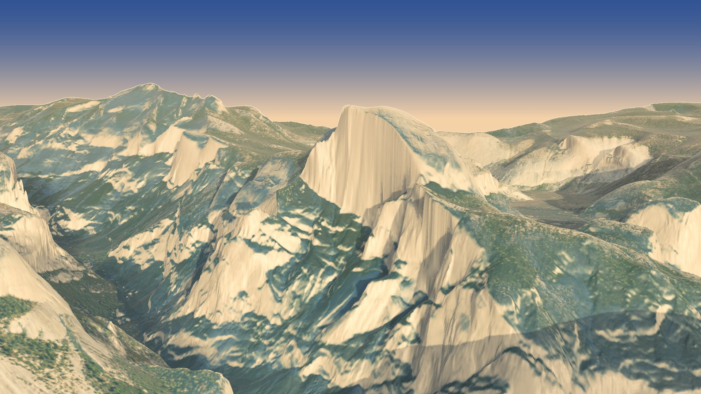
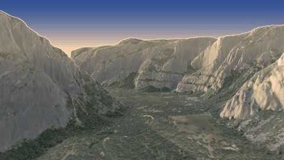

# Yosemite Valley flyover



A 73-second flight through Yosemite Valley on a June evening, rendered with [forge3d](https://github.com/milos-agathon/forge3d) 1.40.1:

1. It starts hovering over Tenaya Canyon, facing Half Dome's sheer north-west face, lit head-on by the low sun.
2. It slides down along the face and into the valley.
3. It flies west about 380 m above the floor, past Curry Village, Sentinel Bridge and Yosemite Falls, then between El Capitan and Cathedral Rocks, then past Bridalveil Fall.
4. It makes a turn over the Merced gorge and rolls out on the Tunnel View picture on a long lens.
5. It flies back up the valley and settles on Half Dome from Sentinel Bridge.

The aerial photos are taken from straight above at midday, so on cliffs they're smeared and in shadow. `prep` gives faces steeper than about 50 degrees a granite tone instead, and the renderer's evening sun lights them. Each frame then gets a painted evening sky, a golden-hour grade and distance haze.



## Run it

```powershell
pixi install
pixi run data       # downloads about 1-2 GB the first time (lidar tiles + imagery)
pixi run prep
pixi run path       # draws the flight on a map (out\flight_map.png); no rendering
pixi run preview    # quick 640x360 check of the whole flight -> out\preview.mp4
pixi run stills     # eight full-size frames along the flight -> out\stills\
pixi run render     # the whole flight, 1920x1080 at 30 fps -> out\yosemite_valley_flyover.mp4
```

To change the flight, edit `KEYS` in `scripts/flight.py`. Each keyframe is an eye point and an aim point (latitude, longitude, altitude in metres), the speed through it and the lens. The timing follows from the speeds.

The path is checked against the terrain and lifted wherever it would pass within 110 m of the ground.

## Data

- **Terrain:** USGS 3DEP 1 m lidar (Yosemite National Park 2019), averaged to 3 m. USGS 3DEP 1/3 arc-second (10 m) fills anything outside it.
- **Imagery:** USDA NAIP via the USGS National Map. It is 4 m over the whole area and 1.5 m over the valley.
- **Sun:** placed for 20 June 2026 at 7:15 pm PDT with `forge3d.sun_position_utc`.

## The notebook

**[notebooks/yosemite.ipynb](notebooks/yosemite.ipynb)** walks through how the film is made, with the project's own scripts: the terrain and what forge3d's viewer actually meshes (about 11 m between vertices across the 23 km box), the granite trick on the cliffs, the flight (keyframes, speed, lens and clearance over time, drawn on a map), the evening Sun, and four frames rendered straight from forge3d and then finished. It's saved with its outputs, so it reads without running anything. To run it yourself you'll need `pixi run data` and `pixi run prep` first, plus matplotlib and Jupyter, which aren't in this project's pixi environment. Sections 1–4 need no renderer; section 5 opens the forge3d viewer.

## Layout

```
scripts/config.py      the area, the imagery tiles, the Sun's date and time
scripts/fetch_data.py  step 1: lidar tiles + 10 m fill -> 3 m DEM; NAIP imagery
scripts/prep.py        step 2: light DEM blur; graded imagery with granite on the cliffs
scripts/flight.py      the keyframes and the path (pixi run path draws it on a map)
scripts/render.py      step 3: forge3d viewer -> evening finish -> ffmpeg
notebooks/             the walkthrough, saved with its outputs
assets/                README images
```

The data (`data/`, about 1–2 GB) and the film (`out/`) aren't in the repo; `pixi run data` and `pixi run render` rebuild them.
